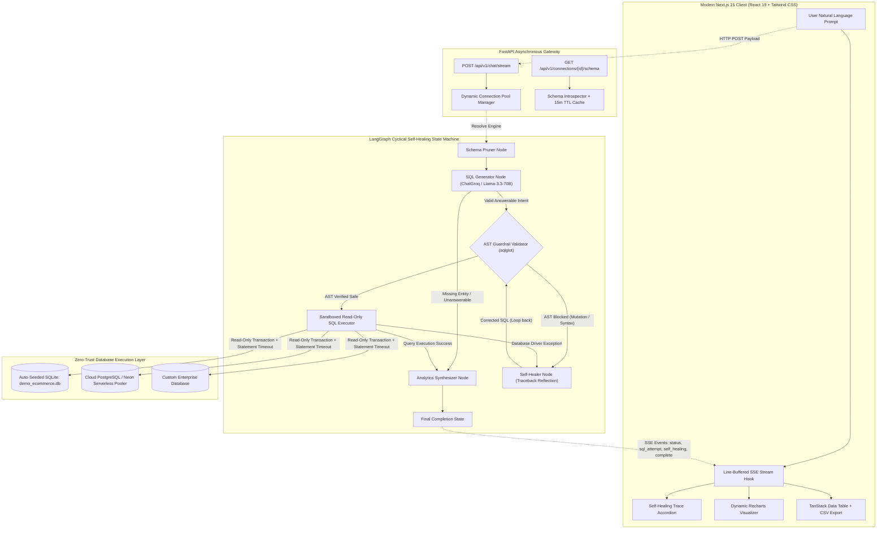

# Self-Healing Text-to-SQL Analytics Agent 🛡️📊

[](https://www.python.org/)
[](https://fastapi.tiangolo.com/)
[](https://www.langchain.com/langgraph)
[](https://groq.com/)
[](https://nextjs.org/)
[](https://www.typescriptlang.org/)
[](https://www.sqlalchemy.org/)
[](https://github.com/tobymao/sqlglot)
[-success?style=for-the-badge&logo=pytest&logoColor=white)](https://docs.pytest.org/)

> **A production-grade, full-stack autonomous analytics platform that connects to any relational database (PostgreSQL, MySQL, SQLite, Neon Serverless, MSSQL), converts natural language questions into strictly validated read-only SQL, automatically heals syntax and schema errors via database traceback reflection, and streams live reasoning steps and interactive BI visualizations directly to a modern dashboard.**

---

## 1. The Problem vs. Our Engineering Solution

Traditional Text-to-SQL solutions fail in enterprise environments because LLMs frequently hallucinate column names, generate dialect-incompatible syntax, and introduce severe SQL injection vulnerabilities when granted direct database access. 

This system replaces fragile one-shot prompting with a **deterministic, 3-layer zero-trust state machine**:

| Challenge | Naive / Standard Text-to-SQL Bots | Our Self-Healing Analytics Agent |
| :--- | :--- | :--- |
| **Hallucinated Columns & Typo Errors** | ❌ Fails immediately with a raw 500 error or crashes the database connection when an invalid column or join is queried. | ✅ **Autonomous LangGraph Self-Healing Loop:** Automatically intercepts driver tracebacks, reflects on the catalog, rewrites the query, and retries up to 3 times in under 3 seconds. |
| **Destructive SQL Injection (`DROP`/`DELETE`)** | ❌ Relies solely on system prompt instructions (e.g. *"Please do not drop tables"*), which are easily bypassed via prompt injection. | ✅ **3-Layer Zero-Trust Security:** Validates query AST via `sqlglot` (blocks all mutations & CTE deletions), enforces an automatic `LIMIT 500` ceiling, and executes inside dialect-level read-only transactions. |
| **Context Window Overload on Large Schemas** | ❌ Dumps hundreds of raw table definitions into the LLM context, spiking token costs and increasing hallucination rates. | ✅ **Smart Schema Pruning & TTL Caching:** Compresses schemas into token-efficient DDL with 3 sample rows per table, uses LLM-powered relevance selection on >10 tables, and caches metadata in-memory for 15 minutes. |
| **Black-Box User Experience** | ❌ Users stare at an empty loading spinner for 10–20 seconds with zero visibility into what the AI is doing. | ✅ **Real-Time Line-Buffered SSE Streaming:** Streams intermediate agent states live (`schema_selection` → `sql_attempt` → `self_healing` diagnosis → `complete`) without freezing the UI. |
| **Raw Text & Markdown Output** | ❌ Returns unformatted markdown tables or text blocks that require manual parsing by business users. | ✅ **Dynamic BI Synthesis:** Automatically synthesizes optimal visualization specifications (`bar`, `line`, `area`, `pie`, `kpi`) rendered via Recharts, paired with a sortable, CSV-exportable TanStack Data Table. |
| **Unanswerable / Missing Table Prompts** | ❌ Hallucinates unrelated tables or crashes with provider-specific tool call errors (e.g. Groq `400 tool_use_failed`). | ✅ **Safe Schema Clarification:** Identifies missing entities, halts database execution, and politely lists available tables with 0 rows returned. |

---

## 2. Visual System Architecture & Data Flow



### The 6-Step Autonomous Lifecycle Explained in Plain English

1. **Schema Discovery & Context Pruning (`schema_pruner_node`):**
   When the user submits a question, the agent inspects the target database schema using SQLAlchemy 2.0 reflection. If the database catalog exceeds 10 tables, the agent intelligently prunes irrelevant tables, extracting only the minimal necessary catalog and formatting it into a compact, token-efficient DDL block with 3 sample rows.
2. **Dialect-Aware SQL Synthesis (`sql_generator_node`):**
   Powered by Groq's low-latency inference (`llama-3.3-70b-versatile`), the agent synthesizes an optimal read-only SQL statement tuned to the specific database dialect (PostgreSQL, SQLite, MySQL, or MSSQL). If the question references non-existent entities (e.g. asking for "employees" in an e-commerce database), it flags `is_answerable = False` and routes directly to clarification, preventing blind hallucinations.
3. **Zero-Trust AST Security Inspection (`ast_validator_node`):**
   Before any query is allowed to touch the database, it is parsed into an Abstract Syntax Tree using `sqlglot`. The validator verifies that the root AST node is strictly a `Select` or `Union` and traverses all Common Table Expressions (CTEs) and sub-queries to block data mutations (`INSERT`, `UPDATE`, `DELETE`, `DROP`, `TRUNCATE`, `ALTER`, `GRANT`, `REVOKE`, `COPY`). It also injects or caps an automatic `LIMIT 500` ceiling to protect against memory exhaustion.
4. **Sandboxed Read-Only Database Execution (`sql_executor_node`):**
   The validated query is executed via an isolated SQLAlchemy engine pool with a strict 10-second statement timeout and session-level read-only constraints (`SET TRANSACTION READ ONLY` on Postgres/MySQL; `PRAGMA query_only = ON` on SQLite). Cloud pooler connections (such as Neon Serverless PgBouncer) are safely handled with non-blocking session guards.
5. **Cyclical Self-Healing Reflection (`self_healer_node`):**
   If a query fails during AST validation or database execution (e.g. an ambiguous column, missing join, or column name typo), the agent intercepts the driver error traceback and query text. The reflector node analyzes the error against the schema, writes a diagnosis, increments the attempt counter, and routes the repaired query back to the AST validator (bounded at 3 attempts).
6. **BI Insights & Real-Time Streaming Synthesis (`analytics_synthesizer_node`):**
   Upon successful execution, the agent synthesizes executive business insights and outputs a structured `ChartConfig` (`bar`, `line`, `area`, `pie`, `kpi`). The entire journey is streamed live to the Next.js client via Server-Sent Events (SSE).

---

## 3. Technology Stack

| Layer | Component | Version / Technology | Purpose |
| :--- | :--- | :--- | :--- |
| **Frontend** | Framework | Next.js 15.5+ (App Router, React 19) | Modern component architecture, server rendering, client hydration |
| | Language | TypeScript 5.0+ | Strict type safety across all SSE payloads, chart models, and API responses |
| | Styling & UI | Tailwind CSS + Lucide React | Polished glassmorphism, responsive dark-mode aesthetics |
| | Visualizations | Recharts 2.15+ | Responsive rendering for Bar, Line, Area, and Donut/Pie charts |
| | Data Exploration | TanStack Table v8 (`@tanstack/react-table`) | Sortable, paginated, and client-side CSV-exportable data grid |
| | Streaming Hook | Line-Buffered `fetch` ReadableStream | Handles fragmented SSE network chunks without dropped frames |
| **Backend & API** | Framework | FastAPI 0.115+ & Starlette | High-concurrency ASGI asynchronous web gateway |
| | Server | Uvicorn 0.32+ | High-throughput asynchronous server with WatchFiles reload |
| | Validation | Pydantic v2.9+ & Pydantic-Settings | Strict request/response validation and environment schema |
| | Streaming | `sse-starlette` 2.1+ | Real-time Server-Sent Events with RFC-8259 JSON compliance |
| **AI & Orchestration** | Agent State | LangGraph 0.2.45+ (`StateGraph`) | Cyclical state machine managing the self-healing feedback loop |
| | Core Framework | LangChain 0.3.7+ & `langchain-core` | Structured prompt templates and output parser chains |
| | Model Provider | LangChain Groq (`langchain-groq` 0.2+) | Sub-second inference via `llama-3.3-70b-versatile` |
| | Output Safety | Pydantic v2 `.with_structured_output()` | Enforces deterministic JSON output schemas for all agent steps |
| **Database & Security** | ORM / Engine | SQLAlchemy 2.0.36+ | Multi-dialect connection pooling (`QueuePool`, `NullPool`, `StaticPool`) |
| | AST Guardrails | `sqlglot` 25.30+ | Abstract Syntax Tree validation, mutation blocking, dialect transpilation |
| | Encryption | Cryptography 43.0+ (Fernet) | AES-128-CBC authenticated symmetric encryption for database URIs |
| | Drivers | `psycopg[binary]>=3.2` (PostgreSQL), `pymysql` (MySQL), `sqlite3` | Native cross-platform database connectors (including Python 3.14 Windows wheels) |
| **DevOps & QA** | Containerization | Docker & Docker Compose | Multi-container setup (Backend, Frontend, PostgreSQL Demo) |
| | Test Suite | Pytest 8.0+ & Pytest-Asyncio | 96 automated tests covering unit, security fuzzing, and stress concurrency |

---

## 4. Repository Structure

```
self-healing-text-to-sql/
├── backend/
│   ├── app/
│   │   ├── agent/                    # LangGraph Self-Healing Agent Engine
│   │   │   ├── graph.py              # Cyclical StateGraph definition & SSE streaming generator
│   │   │   ├── nodes.py              # 6 workflow nodes (pruner, generator, validator, executor, healer, synthesizer)
│   │   │   ├── prompts.py            # Dialect-tuned system & reflection prompts
│   │   │   └── state.py              # AgentState TypedDict & Pydantic v2 structured output schemas
│   │   ├── api/                      # FastAPI REST & Streaming Routes
│   │   │   ├── chat.py               # POST /api/v1/chat/stream (SSE) & POST /api/v1/chat/query
│   │   │   └── connections.py        # Connection registration, testing, schema introspection & deletion
│   │   ├── core/                     # Configuration & Security Primitives
│   │   │   ├── config.py             # Pydantic-Settings v2 with validation & defaults
│   │   │   └── security.py           # Fernet encryption, decryption, and credential masking
│   │   ├── db/                       # Database Management & Guardrails
│   │   │   ├── guardrails.py         # sqlglot AST parsing, mutation blocker & LIMIT injector
│   │   │   ├── introspector.py       # SQLAlchemy 2.0 schema reflection, DDL generator & TTL cache
│   │   │   ├── manager.py            # Dynamic connection pooling, URI normalizer & read-only execution
│   │   │   └── seed_demo.py          # Deterministic seeder for 6-table SQLite demo database
│   │   └── main.py                   # FastAPI app factory, CORS middleware & lifespan lifecycle
│   ├── scripts/
│   │   └── live_smoke_test.py        # End-to-end live Groq inference verification script
│   ├── tests/                        # Comprehensive 96-Test Automated QA Suite
│   │   ├── test_agent_graph.py       # LangGraph state machine & unanswerable query recovery tests
│   │   ├── test_api.py               # REST endpoints & SSE stream format tests
│   │   ├── test_e2e_demo.py          # End-to-end multi-table query tests on seeded demo database
│   │   ├── test_guardrails.py        # AST SQL injection, nested CTE & mutation blocking tests
│   │   ├── test_introspector.py      # Schema introspection, compact DDL & cache invalidation tests
│   │   ├── test_manager.py           # Connection pooling, Neon pooler & read-only session tests
│   │   ├── test_security.py          # Fernet cryptographic roundtrips & credential masking tests
│   │   └── test_stress_chaos_security.py # 25 concurrent streams, red-team fuzzing & toxic float tests
│   ├── .env.example                  # Environment variable configuration template
│   ├── Dockerfile                    # Production multi-stage backend container definition
│   └── pyproject.toml                # Hatchling project metadata & dependency declarations
│
├── frontend/
│   ├── src/
│   │   ├── app/                      # Next.js 15 App Router
│   │   │   ├── layout.tsx            # Root layout with metadata and fonts
│   │   │   └── page.tsx              # Main analytics studio page assembling sidebar, chat & results
│   │   ├── components/               # Modular UI Components
│   │   │   ├── analytics/
│   │   │   │   ├── DataTable.tsx     # TanStack table with column sorting, pagination & CSV export
│   │   │   │   ├── DynamicChart.tsx  # Dynamic Recharts renderer (Bar, Line, Area, Pie, KPI)
│   │   │   │   └── ResultCard.tsx    # Tabbed view switching between Chart, Data Grid, and SQL
│   │   │   ├── chat/
│   │   │   │   ├── ChatWorkspace.tsx # Central query bar, quick prompt suggestions & message list
│   │   │   │   └── HealingTraceAccordion.tsx # Collapsible visual diff showing self-healing attempts
│   │   │   ├── connections/
│   │   │   │   └── ConnectionModal.tsx # Dialog to connect PostgreSQL, MySQL, SQLite, Neon, or MSSQL
│   │   │   └── sidebar/
│   │   │       └── SchemaTree.tsx    # Left sidebar exploring tables, columns, types & sample records
│   │   ├── hooks/
│   │   │   └── useAgentStream.ts     # Resilient line-buffered SSE hook with real-time state tracking
│   │   ├── lib/
│   │   │   └── utils.ts              # Tailwind CSS class merger (clsx + twMerge)
│   │   └── types/
│   │       └── agent.ts              # TypeScript interfaces mirroring backend SSE payloads 1:1
│   ├── Dockerfile                    # Next.js 15 standalone production container definition
│   ├── package.json                  # Frontend dependencies & scripts
│   └── tsconfig.json                 # Strict TypeScript configuration
│
├── infra/
│   └── postgres/
│       └── init.sql                  # Automated seeding script for Docker PostgreSQL container
├── docker-compose.yml                # Unified multi-service orchestration (Backend + Frontend + Postgres)
└── README.md                         # Project documentation
```

---

## 5. Zero-Friction Quickstart Guide

### Prerequisites
- **Python 3.11+** (tested up to Python 3.14 on Windows, Linux, and macOS)
- **Node.js 20+** and `npm`
- A free **Groq Cloud API Key** from [console.groq.com](https://console.groq.com)

---

### Option 1: Docker Compose (1-Command Full Stack)

Run the entire multi-container production stack (Next.js 15 frontend, FastAPI backend, and pre-seeded PostgreSQL database) with a single command:

```bash
# 1. Clone the repository
git clone https://github.com/your-username/self-healing-text-to-sql.git
cd self-healing-text-to-sql

# 2. Set your Groq API key in your terminal session or create a .env file
export GROQ_API_KEY="gsk_your_actual_groq_api_key_here"  # Linux / macOS
# $env:GROQ_API_KEY="gsk_your_actual_groq_api_key_here"  # Windows PowerShell

# 3. Launch the container stack
docker compose up --build
```

**Services will be live at:**
- 🌐 **Web Studio:** `http://localhost:3000`
- ⚙️ **FastAPI OpenAPI Swagger:** `http://localhost:8000/docs`
- 🐘 **PostgreSQL Demo DB:** `localhost:5432` (`demo_analytics`, user: `postgres`, password: `postgrespassword`)

---

### Option 2: Local Development on Windows (PowerShell)

#### Step 1: Backend Setup
```powershell
# Open Windows PowerShell in the project root
cd "d:\My_Projects\Self-Healing Text-to-SQL Analytics Agent"

# Create virtual environment and activate
python -m venv .venv
.\.venv\Scripts\Activate.ps1

# Install backend package and dependencies
cd backend
python -m pip install --upgrade pip
pip install -e ".[dev]"

# Create your .env file
Copy-Item .env.example .env
```

Edit `backend/.env` with your preferred editor and set your `GROQ_API_KEY`:
```ini
GROQ_API_KEY=gsk_your_actual_groq_api_key_here
GROQ_MODEL=llama-3.3-70b-versatile
ENCRYPTION_KEY=your_fernet_key_or_leave_empty_for_auto_dev_key
AUTO_SEED_DEMO=true
DEMO_DB_FILENAME=demo_ecommerce.db
```

Launch the backend with auto-reload:
```powershell
uvicorn app.main:app --reload --port 8000
```
*(On first startup, the backend automatically seeds `demo_ecommerce.db` with 160+ realistic e-commerce records!)*

#### Step 2: Frontend Setup
Open a second PowerShell window:
```powershell
cd "d:\My_Projects\Self-Healing Text-to-SQL Analytics Agent\frontend"

# Install dependencies
npm install

# Start Next.js development server
npm run dev
```
Open **`http://localhost:3000`** in your browser.

---

### Option 3: Local Development on Linux / macOS / Git Bash

```bash
# 1. Clone and navigate
git clone https://github.com/your-username/self-healing-text-to-sql.git
cd self-healing-text-to-sql

# 2. Setup backend
python3 -m venv .venv
source .venv/bin/activate
cd backend
pip install --upgrade pip
pip install -e ".[dev]"
cp .env.example .env

# Edit backend/.env and insert your GROQ_API_KEY
nano .env

# Launch backend
uvicorn app.main:app --reload --port 8000 &

# 3. Setup frontend (in a new terminal tab)
cd ../frontend
npm install
npm run dev
```

---

## 6. The Auto-Seeded Demo Database

To ensure the application is testable out of the box with zero external configuration, the backend automatically generates a relational **E-Commerce & SaaS Analytics Database** (`demo_ecommerce.db` for SQLite and `init.sql` for Docker Postgres):

```
+---------------------------------------------------------------------------------------------------+
|                                  DEMO RELATIONAL DATABASE SCHEMA                                  |
+---------------------------------------------------------------------------------------------------+

  customers                     categories                   products
 +--------------------+        +--------------------+       +--------------------+
 | customer_id (PK)   |        | category_id (PK)   |<---+  | product_id (PK)    |
 | full_name          |        | category_name      |    +--| category_id (FK)   |
 | email              |        | department         |       | product_name       |
 | country            |        +--------------------+       | unit_price         |
 | segment            |                                     | cost_price         |
 | signup_date        |                                     | stock_quantity     |
 +--------------------+                                     +--------------------+
          |                                                           |
          | 1:N                                                       | 1:N
          v                                                           v
       orders                                                    order_items
 +--------------------+                                     +--------------------+
 | order_id (PK)      |<------------------------------------| item_id (PK)       |
 | customer_id (FK)   | 1:N                                 | order_id (FK)      |
 | order_date         |                                     | product_id (FK)    |
 | order_status       |                                     | quantity           |
 | shipping_country   |                                     | unit_price         |
 | discount_amount    |                                     | line_total         |
 | total_amount       |                                     +--------------------+
 +--------------------+

  marketing_campaigns
 +----------------------------------------------------------------------------------+
 | campaign_id (PK) | campaign_name | channel | budget_usd | spend_usd | conversions |
 +----------------------------------------------------------------------------------+
```

---

## 7. Interactive Showcase Prompts

Use the curated prompts below to test every core architectural capability:

| Feature Tested | Natural Language Prompt | Expected System Behavior & Visualization |
| :--- | :--- | :--- |
| **Multi-Table Join & Bar Chart** | *"What are the top 5 products by total revenue from completed orders?"* | Synthesizes a 3-table join (`products` ⨝ `order_items` ⨝ `orders`), groups by product name, and renders an interactive **Bar Chart** with dollar-formatted tooltips. |
| **Time-Series Aggregation & Line Chart** | *"Show monthly order count and total revenue across 2024."* | Uses dialect-aware date functions (`strftime('%Y-%m', order_date)`) and renders a dual-metric **Line Chart** displaying seasonal sales trends. |
| **Categorical Segment & Pie Chart** | *"What is the distribution of customers across Enterprise, SMB, and Consumer segments?"* | Aggregates customer counts grouped by `segment` and renders a multi-colored **Pie / Donut Chart** with percentage legends. |
| **Executive Metric & KPI Card** | *"What is our overall gross revenue from completed orders?"* | Calculates `SUM(total_amount)` and renders a high-impact **KPI Metric Card** with business context. |
| **Zero-Row Result Handling** | *"Show all orders placed in the year 1995."* | Executes a valid query returning 0 rows; gracefully renders an informative empty state without breaking the UI. |
| **Unanswerable / Missing Table Protection** | *"Count all employees in the organization."* | Identifies that `employees` does not exist in the schema; cleanly outputs a polite schema clarification listing available tables with zero failed SQL executions. |
| **Red-Team Security Guardrail Block** | *"DROP TABLE customers"* or *"SELECT * FROM customers; DELETE FROM orders;"* | **Zero-Trust Block:** `sqlglot` intercepts destructive statements before execution. Intercepted with message: `Destructive statement 'Drop'/'Delete' is strictly forbidden.` |
| **Autonomous Self-Healing Loop** | *"List the top 5 customers by their total_spend from the orders table using the cust_tier column."* | **Attempt 1:** Fails with `no such column: cust_tier`.<br>**Reflection:** Diagnoses that `segment` is the valid customer tier column.<br>**Attempt 2:** Successfully heals query; UI displays **Self-Healing Accordion** with before/after diff! |

---

## 8. API Reference & Real-Time SSE Stream Contract

### REST Endpoints Summary

| Method | Endpoint | Description |
| :--- | :--- | :--- |
| `GET` | `/health` | Healthcheck returning service status, version, and timestamp |
| `GET` | `/api/v1/connections` | List all saved database connections with masked connection strings |
| `POST` | `/api/v1/connections` | Register and encrypt a new database connection (Fernet AES-128-CBC) |
| `POST` | `/api/v1/connections/test` | Test credentials, dialect compatibility, and round-trip ping latency |
| `GET` | `/api/v1/connections/{id}/schema` | Retrieve compact DDL schema metadata and sample records |
| `DELETE` | `/api/v1/connections/{id}` | Close active SQLAlchemy engine pools and remove connection |
| `POST` | `/api/v1/chat/stream` | **Primary Endpoint:** Real-time Server-Sent Events (SSE) agent pipeline |
| `POST` | `/api/v1/chat/query` | Synchronous REST endpoint returning full agent execution state |

---

### Real-Time Server-Sent Events (SSE) Protocol (`POST /api/v1/chat/stream`)

The streaming endpoint yields standard Server-Sent Events (`text/event-stream`) formatted in strict **RFC-8259 JSON** (with automated `NaN`/`Infinity` sanitization):

```
POST /api/v1/chat/stream
Content-Type: application/json

{
  "connection_id": "conn_demo_ecommerce",
  "question": "What are our top 5 products by revenue?"
}
```

#### Event 1: `status` (Progression Milestone)
```json
data: {"event": "status", "step": "schema_selection", "message": "Extracted schema metadata for sqlite database."}

data: {"event": "status", "step": "sql_generation", "message": "Synthesized initial SQL query."}
```

#### Event 2: `sql_attempt` (SQL Generation Trace)
```json
data: {
  "event": "sql_attempt",
  "attempt": 1,
  "sql": "SELECT p.product_name, SUM(oi.line_total) AS revenue FROM products p JOIN order_items oi ON p.product_id = oi.product_id GROUP BY p.product_name ORDER BY revenue DESC LIMIT 5",
  "thought_process": "Joining products and order_items on product_id to aggregate revenue by product."
}
```

#### Event 3: `self_healing` (Triggered on Error)
```json
data: {
  "event": "self_healing",
  "attempt": 1,
  "error": "(sqlite3.OperationalError) no such column: p.price",
  "diagnosis": "Column 'price' does not exist in 'products'. The correct unit price column is 'unit_price'."
}
```

#### Event 4: `complete` (Final Synthesis with Data & Chart)
```json
data: {
  "event": "complete",
  "sql": "SELECT p.product_name, SUM(oi.line_total) AS total_revenue FROM products p JOIN order_items oi ON p.product_id = oi.product_id GROUP BY p.product_name ORDER BY total_revenue DESC LIMIT 5",
  "data": [
    {"product_name": "Cloud Migration Suite", "total_revenue": 149950.0},
    {"product_name": "Enterprise Security Gateway", "total_revenue": 128400.0},
    {"product_name": "DevOps Pipeline Automation", "total_revenue": 95200.0},
    {"product_name": "AI Analytics Accelerator", "total_revenue": 87500.0},
    {"product_name": "Microservices Mesh License", "total_revenue": 64200.0}
  ],
  "columns": ["product_name", "total_revenue"],
  "row_count": 5,
  "attempts": 1,
  "healing_trace": [],
  "summary": "Revenue is heavily concentrated in enterprise infrastructure solutions, led by the **Cloud Migration Suite** ($149,950) and **Enterprise Security Gateway** ($128,400).",
  "chart_config": {
    "chart_type": "bar",
    "title": "Top 5 Products by Revenue",
    "x_axis_key": "product_name",
    "y_axis_keys": ["total_revenue"]
  },
  "execution_time_ms": 4.12
}
```

---

## 9. Automated Testing & Production Verification

The project is backed by a comprehensive **96-test automated QA suite** spanning unit, integration, stress concurrency, and adversarial red-team fuzzing:

### Running the Test Suite
```bash
# Activate your virtual environment and run Pytest
cd backend
pytest tests -v
```

```text
============================== test session starts ==============================
collected 96 items

tests/test_agent_graph.py::test_first_try_success PASSED                         [  1%]
tests/test_agent_graph.py::test_self_healing_from_execution_error PASSED         [  2%]
tests/test_agent_graph.py::test_self_healing_from_ast_security_violation PASSED   [  3%]
tests/test_agent_graph.py::test_max_retries_exhausted_terminates_gracefully PASSED [  4%]
tests/test_agent_graph.py::test_unanswerable_missing_table_question_bypasses_sql PASSED [ 5%]
tests/test_agent_graph.py::test_groq_tool_use_failed_handled_cleanly PASSED     [  6%]
tests/test_api.py::test_health_endpoint PASSED                                   [  7%]
tests/test_api.py::test_create_and_list_connections PASSED                       [  8%]
tests/test_api.py::test_test_connection_endpoint PASSED                          [  9%]
tests/test_api.py::test_get_connection_schema PASSED                             [ 10%]
tests/test_api.py::test_chat_stream_sse_endpoint PASSED                           [ 11%]
tests/test_guardrails.py::test_valid_select_query PASSED                         [ 12%]
tests/test_guardrails.py::test_destructive_sql_blocked[DROP TABLE users] PASSED  [ 13%]
tests/test_guardrails.py::test_destructive_sql_blocked[DELETE FROM users] PASSED  [ 14%]
tests/test_guardrails.py::test_destructive_sql_blocked[UPDATE users SET ...] PASSED [ 15%]
tests/test_guardrails.py::test_nested_cte_mutation_blocked PASSED                [ 16%]
tests/test_manager.py::test_normalize_database_uri_neon_and_drivers PASSED      [ 17%]
tests/test_manager.py::test_pooler_safe_configure_read_only_session PASSED      [ 18%]
tests/test_stress_chaos_security.py::test_high_concurrency_stress_25_streams_and_15_schemas PASSED [ 19%]
tests/test_stress_chaos_security.py::test_red_team_adversarial_sql_fuzzing[...] PASSED (35 vectors)
tests/test_stress_chaos_security.py::test_toxic_floats_nan_and_infinity_serialized_to_null PASSED
tests/test_stress_chaos_security.py::test_mid_stream_client_disconnect_no_leaks PASSED
...
============================== 96 passed in 2.29s ==============================
```

---

### Live Groq Cloud End-to-End Smoke Test

Run the live inference verification script against real Groq Cloud infrastructure:

```bash
cd backend
python scripts/live_smoke_test.py
```

```text
====================================================================================================
  🚀 SELF-HEALING TEXT-TO-SQL: LIVE GROQ E2E SMOKE TEST SUITE
====================================================================================================
• Groq Model:     openai/gpt-oss-120b
• Database URI:   sqlite:///D:/My_Projects/.../backend/demo_ecommerce.db

  📊 LIVE GROQ E2E SMOKE TEST SUMMARY TABLE
====================================================================================================
#   | Query Description                | Status     | Latency    | Attempts | Rows   | Chart   
----------------------------------------------------------------------------------------------------
1   | Multi-table Join + Bar Chart     | PASS ✅     | 3260.8 ms  | 1        | 5      | bar     
2   | Time-Series Aggregation          | PASS ✅     | 3298.9 ms  | 1        | 12     | line    
3   | Intentional Self-Healing Trigger | PASS ✅     | 1267.5 ms  | 1        | 0      | none    
4   | Zero-Row Result                  | PASS ✅     | 4321.6 ms  | 1        | 0      | none    
====================================================================================================
🎉 ALL 4 LIVE GROQ E2E SMOKE TESTS PASSED CLEANLY!
====================================================================================================
```

---

## 10. Production Hardening Highlights

1. **Python 3.14 on Windows Ready:** Native `psycopg[binary]>=3.2.0` wheels installed directly in virtual environments with `pg8000` pure-Python fallback.
2. **Neon Serverless & PgBouncer Compatibility:** Driver normalization strips `channel_binding=require` to prevent SCRAM channel-binding handshake aborts while enforcing strict SSL. Session-level read-only configurations gracefully handle poolers operating in transaction mode.
3. **Strict RFC-8259 JSON Sanitization:** Custom recursive serializes custom date, UUID, and Decimal types, and maps non-standard floats (`NaN`, `+Infinity`, `-Infinity`) to standard `null` so browser JSON parsers never crash.
4. **Connection Pool Resource Leak Prevention:** LRU connection cache evicts idle database engines and closes thread pools when capacity is exceeded.
5. **Client Disconnect Clean-Up:** Asynchronous SSE generators listen for client disconnection events and terminate database queries and background tasks immediately.

---

## 11. License

This project is licensed under the **MIT License**. Free for personal and commercial use in modern, high-trust autonomous enterprise analytics.
